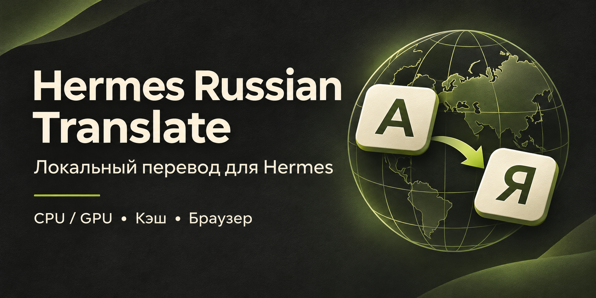

# Hermes Russian Translate



**Русский перевод плагинов, навыков, шаблонов задач и страниц встроенного браузера в Hermes Desktop. Локально, без API-ключа и оплаты за перевод.**

Описания заменяются прямо на странице. Перевод сохраняется: при следующем открытии знакомый текст берётся из кэша, а модель нужна только для новых или изменившихся фрагментов.

**Статус:** самостоятельный community-плагин, первый публичный выпуск 1.0.0. Это не официальный компонент Nous Research. В официальный каталог Hermes пока не включён: перевод основного интерфейса использует адаптер разметки, который не допускается правилами каталога. Мы [обсуждаем официальный способ расширения](https://github.com/NousResearch/hermes-agent/pull/148840). Не устанавливайте плагин, если вам нужна исключительно совместимость с правилами курируемого каталога.

## Что переводит

| Раздел | Поведение |
| --- | --- |
| Плагины / Plugins | Видимые описания карточек, подробные описания, часть подписей и подсказок |
| Навыки / Skills | Описания карточек и подробностей, некоторые человекочитаемые заголовки |
| Запланированные задачи | Подписи, пояснения и названия встроенных шаблонов |
| Встроенный браузер справа | Текст текущей страницы по кнопке **«Перевести сайт»** |

Названия пакетов, технические идентификаторы, отдельные адреса, пути, код и поля ввода сохраняются. Инструкции навыков на диске, манифесты плагинов, расписания и ваши задания не переписываются. Это перевод отображения.

Верхняя панель показывает **CPU/GPU**, выбранную модель и состояние. Там же можно включить/выключить перевод, явно загрузить или выгрузить переводчик. Переключение пункта в списке само модель не запускает. Чтобы освободить ресурсы, нажимайте **«выгрузить»**: закрытие окна Hermes само по себе не гарантирует остановку отдельного процесса переводчика.

## Установка на Windows — по шагам

Подготовлено для **Windows 10/11 x64 и Hermes Desktop 0.23.1**. Обычный CPU-режим не требует отдельной видеокарты. Нужен Python 3.10+ — установщик попробует найти Python, поставляемый вместе с Hermes. Если его нет, установите [Python с python.org](https://www.python.org/downloads/windows/).

Выделите около **2.1 ГБ на диске** для модели и движка. Для первого запуска рекомендуем **не менее 4 ГБ свободной оперативной памяти** сверх потребления системы; это ориентир с запасом, а не замер минимального ноутбука. Видеорежим требует совместимого с Vulkan драйвера и свободной видеопамяти. Очень старые CPU и Windows ARM не проверены.

### 1. Установите плагин

Откройте **PowerShell** и вставьте:

```powershell
hermes plugins install konstanaft-stack/hermes-russian-translate --enable
```

Либо в Hermes откройте **Возможности → Plugins → Установить из Git** и вставьте:

```text
https://github.com/konstanaft-stack/hermes-russian-translate
```

Если Hermes предложит установить Node-зависимости, ответьте **N**: они нужны только разработчикам для тестов, готовый плагин работает без них. Зависимость Python `psutil` можно установить штатным предложением Hermes.

Это пользовательский плагин вне каталога. Прочитайте показанные Hermes сведения и предупреждения: он меняет текст отображаемых страниц и запускает локальный движок по вашему запросу. Плагин не отключает проверки или подтверждения Hermes.

### 2. Один раз подготовьте переводчик

В **том же PowerShell** перейдите в папку установленного плагина:

```powershell
if ($env:HERMES_HOME) { $translateHome = $env:HERMES_HOME } elseif ($env:LOCALAPPDATA) { $translateHome = Join-Path $env:LOCALAPPDATA 'hermes' } else { $translateHome = Join-Path $env:USERPROFILE '.hermes' }
Set-Location (Join-Path $translateHome 'plugins/hermes-ru-translator')
```

**Обычный ноутбук, без отдельной видеокарты:**

```powershell
powershell -NoProfile -ExecutionPolicy Bypass -File .\install.ps1 -Cpu
```

**Для перевода на видеокарте:** вместо предыдущей команды используйте:

```powershell
powershell -NoProfile -ExecutionPolicy Bypass -File .\install.ps1 -Gpu
```

Разрешение PowerShell действует только для этого запуска. Постоянная политика Windows не меняется.

Установщик скачает **около 1.93 ГБ один раз**: HY-MT2 1.8B Q8 от Tencent и CPU- или Vulkan-версию llama.cpp из официального релиза. Файлы закреплены по версии и SHA-256. Уже скачанный исправный файл повторно не скачивается. Установщик **не запускает модель и не обновляет код плагина**. Загрузка может занять время; дождитесь сообщения `Setup complete`.

Для проверки без скачивания:

```powershell
powershell -NoProfile -ExecutionPolicy Bypass -File .\install.ps1 -Check
```

Для просмотра того, что будет скачано, без изменений: замените `-Check` на `-DryRun`.

### 3. Включите интерфейс и перевод

Дождитесь окончания текущих заданий агента. Если backend нового плагина ещё не подхватился, выполните:

```powershell
hermes gateway restart
```

Откройте Hermes снова. В **Возможности → Plugins** найдите **Hermes Russian Translate** и включите его Desktop-часть, если она выключена. При необходимости один раз выполните **Reload desktop plugins** в палитре команд Hermes.

Вверху появится панель перевода. Нажмите **«загрузить»** рядом с HY-MT2 Q8. Откройте плагины или навыки: видимые описания начнут заменяться русскими. Точная подпись кнопки включает имя выбранной модели. После `-Cpu` статус должен показывать **CPU**, после `-Gpu` — **GPU**.

**Не появилась панель:** проверьте именно Desktop-переключатель. Включённый Python backend и включённая Desktop-часть — два разных состояния.

## Ноутбук: перевести один раз и спокойно пользоваться

Первый перевод на CPU может идти заметно медленнее видеокарты. **Это не должно повторяться при каждом открытии той же карточки.**

1. Загрузите переводчик, откройте нужный раздел и подождите первый перевод.
2. Открывайте интересующие карточки или постепенно прокручивайте каталог. Переводятся видимые тексты; скрытые карточки и все сайты интернета заранее не обрабатываются.
3. Готовые переводы записываются в локальный постоянный кэш.
4. Нажмите **«выгрузить»**. Модель освободит ресурсы, уже знакомые описания продолжат показываться из кэша.
5. После появления новых карточек или изменения описания загрузите модель снова. Уже знакомый текст не требует повторной генерации.

**Кнопки «перевести весь каталог за один раз» сейчас нет.** Можно постепенно подготовить просмотренные разделы и затем оставить переводчик выгруженным. При выгруженной модели неизвестный текст остаётся английским до следующей загрузки.

Для слабого CPU можно ограничить потоки, например:

```powershell
powershell -NoProfile -ExecutionPolicy Bypass -File .\install.ps1 -Cpu -Threads 2
```

Если модель уже загружена, сначала выгрузите её кнопкой; новую конфигурацию она прочитает при следующей загрузке. Не запускайте CPU- и GPU-копии одновременно. Скорость CPU Q8 на разных ноутбуках ещё не измерялась, поэтому универсальных секунд на карточку мы не обещаем.

## Перевод сайта во встроенном браузере

Откройте страницу в правом браузере Hermes и нажмите сверху **«Перевести сайт»**. Hermes может запросить разрешение для этого домена. Плагин не подтверждает его за вас.

Текст заменяется на месте. Кнопка **«Оригинал сайта»** возвращает исходный текст. Перевод не запускается на каждом переходе автоматически. После навигации или появления нового содержимого нажмите кнопку снова.

Переводятся текстовые узлы, а не картинки, видео или сканированные PDF. Поля ввода, формы и код пропускаются. Автоматическое распознавание надписей внутри картинок не входит в этот выпуск.

## Как устроен кэш

- **На диске:** база SQLite внутри `HERMES_HOME/cache/ru-translator/cache.db`.
- **В Desktop:** собственное постоянное хранилище плагина для быстрого повторного показа.
- Ключ учитывает исходный текст, язык и версию модели/алгоритма. Изменился текст — переводится новая версия.
- CPU и GPU с теми же Q8-весами используют один ключ модели; перенос вычислений не требует заново переводить весь просмотренный каталог.
- Другая модель или существенное обновление алгоритма могут получить отдельный кэш, чтобы не смешивать результаты.
- Desktop-кэш ограничен по числу записей и размеру. Это не обещание хранить бесконечную историю всех сайтов; backend SQLite сохраняет готовые результаты.

Кэш — локальный открытый текст. При переводе личной страницы её текст и перевод также могут сохраниться локально. Не включайте эти базы в публичные архивы или репозитории. Облачного fallback, телеметрии и отправки текста в переводческие API у плагина нет. Сама открытая страница продолжает работать со своим сайтом обычным образом.

## Модели и ресурсы

| Профиль | Веса | Подготовка |
| --- | --- | --- |
| **HY-MT2 Q8** | Около 1.91 ГБ | Основной вариант. `install.ps1` готовит CPU или GPU |
| HY-MT2 STQ 1.25-bit | Около 462 МБ | Дополнительный вариант для CPU; нужен совместимый STQ-движок и строго совпадающий файл. Автоматически не скачивается |
| StreamRevise v4 Q4 | Около 1.07 ГБ | Дополнительный вариант для GPU; отдельные модель и настройка. В этом выпуске переводит полный фрагмент, не живую ASR-диктовку |

**Для начала оставьте Q8.** STQ и StreamRevise включаются только при явном указании обоих путей в [конфигурации](runtime.example.json). Модели не входят в GitHub-пакет. Плагин проверяет ожидаемые веса и не принимает произвольный GGUF под тем же именем.

Конфигурация: `HERMES_HOME/ru-translator/runtime.json`. Обычно её создаёт установщик; вручную править не требуется. Установщик принимает другой `HERMES_HOME` или `-HermesHome`. Первый выпуск рассчитан на один Hermes home и один переводчик; одновременная работа именованных профилей в общей мультиплексированной службе не проверена и не заявляется поддерживаемой. [Подробности и границы](docs/technical.md).

## Что пока не умеет

- Полностью переводить любой экран Hermes, чат и скрытые рассуждения модели.
- Переводить раздел Tools/Инструменты и Connectors.
- Переводить надписи на картинках, аудио или видео.
- Безошибочно переводить каждую техническую фразу: машинный перевод может ошибаться.
- Гарантировать совместимость разметки с будущими версиями Hermes.
- Ставиться по короткому имени из официального каталога: включение ещё не согласовано.

Проверено в живом Hermes Desktop 0.23.1 на Windows с GPU; переносимый выпуск дополнительно проверяется автоматическими тестами установки, путей, владения процессами, кэша и DOM. На всех моделях ноутбуков тестов нет. Linux/macOS могут использовать ручную конфигурацию совместимого локального движка, но автоматический установщик этого выпуска рассчитан на Windows x64.

## Если что-то не работает

| Симптом | Что сделать |
| --- | --- |
| `hermes` не найден | Используйте установленный Hermes Desktop → Plugins → «Установить из Git», либо исправьте доступ к CLI по инструкции Hermes |
| Нет Python | Укажите `-Python` с путём к Python 3.10+ или установите его с python.org |
| 404 у API / переводчик недоступен | Проверьте включение backend-плагина и перезапустите gateway после завершения заданий |
| Кнопка загрузки сообщает об отсутствующем файле | Запустите подготовку `install.ps1 -Cpu` или `-Gpu` и дождитесь окончания |
| Несовпадение SHA-256 | Не подменяйте хеш. Повторите скачивание из указанного официального источника; если не помогает, создайте issue |
| GPU не запускается | Обновите официальный драйвер с Vulkan или выгрузите модель и подготовьте CPU-режим |
| Знакомый перевод пропал после смены модели | У профилей отдельные версии кэша. Вернитесь к прежней модели или дождитесь нового перевода |
| Кнопки/карточки перестали переводиться после обновления Hermes | Отключите перевод и сообщите версию Hermes и раздел. Не отправляйте личную историю или базу кэша |

## Для разработчиков

Готовый `desktop/plugin.js` включён в репозиторий; обычному пользователю **не нужны Node.js, npm, CMake или сборка C++**.

```text
npm ci
npm run build
npm test
python -m unittest discover -s tests/python -v
python -m unittest discover -s tests/setup -v
```

Для Python API-тестов нужны FastAPI, Pydantic и psutil; они обычно есть в окружении Hermes. JS-тесты используют реальный DOM/React с заглушкой только на границе SDK. Проверку SDK по исходному дереву Hermes можно дополнительно включить переменной `HERMES_DESKTOP_SOURCE`.

Исходный код плагина — [MIT](LICENSE). Лицензии и официальные источники отдельно скачиваемых компонентов: [THIRD_PARTY_NOTICES.md](THIRD_PARTY_NOTICES.md). Обложка сгенерирована для этого проекта; это иллюстрация, не скриншот приложения.

## English

Hermes Russian Translate is a local English-to-Russian display translator for Hermes Desktop plugin/skill descriptions, built-in Cron UI prose and manually selected embedded Browser pages. It offers explicit CPU/GPU model control and persistent translation caches. Windows x64 setup downloads pinned official llama.cpp and Tencent HY-MT2 Q8 files once. No translation cloud API or telemetry is used.

This is an independent community package, not an official Hermes catalog entry. Its current core-UI DOM adapter is incompatible with catalog rule 8; we are requesting a public display-text provider hook instead of a policy exception. Browser translation already uses the public, consent-gated preview API. Images, chat reasoning, arbitrary core screens and automatic full-catalog pretranslation are not supported.
